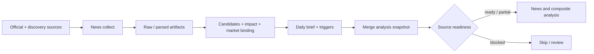

# 新闻数据管线

> 代码基线：2026-07-21。本文描述已实现结构；某个外部来源是否当日可用，以 live source status 和本次 run artifact 为准。

## 当前主链

Dagster ops 包装 `apps/worker/pipelines/news.py`，产物按 `storage/features/news/<date>/<run_id>/` 组织，并进入统一 analysis snapshot。

## 采集源

| source_key / collector | 角色与边界 |
| --- | --- |
| `fed_rss` | Fed 官方发布候选 |
| `bls_calendar` | BLS 官方日历 |
| `bea_schedule` | BEA 官方发布计划 |
| `eia_energy_events` | EIA 官方能源事件 |
| `gdelt_news` | 全球候选发现；需 cooldown/read model |
| `google_news_rss` | 公开候选发现 |
| `reuters_public_news` | 通过公开 RSS 元数据发现 Reuters 候选；不是授权 feed |
| `llm_web_search` | 常规发现源未达到 freshness 目标时的 Responses Web Search 兜底；只接受真实 tool call 返回的 URL |
| `jin10_feishu` | 可选的飞书/Jin10 来源；受 bridge/登录环境约束 |

是否启用和是否成功是两件事。采集失败、cooldown、无结果和认证缺失必须分别记录。


GDELT、Google News 和 Reuters public metadata 属于候选发现层。关键事件只有经过官方或授权来源确认后，才能升级为确认事实。


## 新鲜度与网络兜底

- `news_collect` 基于所有原始候选的 `published_at` 计算 freshness，不把 checkpoint 去重后的“新增 0 条”误判成“没有最新新闻”。
- 默认 freshness 目标为 6 小时，可用 `NEWS_FRESHNESS_MAX_AGE_HOURS` 调整。
- GDELT、Google News RSS、Reuters public metadata 的 query group 遇到连接错误时，会先按 `NEWS_HTTP_PROXY` 或标准代理环境变量做一次有限重试；限流/cooldown 不会通过换路由规避。
- `NEWS_DIRECT_FALLBACK_ENABLED=true` 仅用于已确认直连可用的环境，默认关闭。
- `NEWS_WEB_SEARCH_FALLBACK_ENABLED=true` 后，只有 freshness 不达标才调用 `llm_web_search`。配置的 provider 必须实际支持 Responses `web_search` tool；只接受 tool call 返回 URL 与结构化输出一致的候选。
- LLM Web Search 结果固定为 `supplemental` / `single_source`。停火、开战、制裁等强事实仍需官方或多源确认。
- 常规来源与联网兜底都失败时，artifact 必须显示 `missing/stale`；LLM 不得把“未检索到”改写成“事件不存在”。

## Feature 与 brief

现有处理包括：

- event candidates 与 relevance gate
- impact assessment 与 market binding
- gold event mainlines
- daily analysis triggers
- daily brief input snapshot
- daily market brief
- report event extraction
- follow-up task/read model

新闻结论进入 Agent 前要保留 `source_refs`、input snapshot、retrieved/business date 和 source role。候选发现不能自动升级为 confirmed fact。

## API

- `/api/news/daily-analysis-triggers/latest` 与 query
- `/api/news/daily-brief/latest` 与 query
- `/api/news/daily-analysis-followups/latest` 与 query
- `POST /api/news/daily-analysis-followups/tasks`
- `/api/news/feishu-jin10/messages/latest`、`dates`、`messages`
- `/api/events/*` 和 `/api/processing/*` 提供事件与加工链下钻

## 降级规则

- 单个发现源失败可以产生 partial 结果，但必须保留 warning 和 source status。
- 关键来源 blocked 时，premarket readiness 可以阻止整个 canonical analysis。
- 无公开候选不等于“事件不存在”。
- Feishu/Jin10 不可用时不得用空数组伪装成 live；应标记 unavailable 或 manual-required。
- Reuters public 元数据不得描述为 Reuters 授权正文。

## 验收

- collector 真实写入 raw/parsed artifact，并记录失败原因。
- feature/brief artifact 含 `run_id`、日期、`source_refs` 和 `input_snapshot_ids`。
- `/api/data-sources/status` 与新闻 artifact 对同一 run 的状态一致。
- Event Flow 可消费最新 read model，并保留候选/确认边界。
- 相关 regression：`tests/worker/test_news_pipeline.py` 与 Dagster agent/op tests。

## 相关内容

- [后端主链](02_BACKEND_PIPELINE.md)
- [Agent 架构](05_AGENT_ARCHITECTURE.md)
- [风险与待办](12_RISKS_AND_TODO.md)
